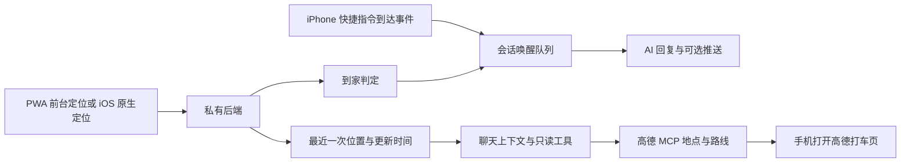

# 给自托管 AI 接入位置、到家迎接和高德打车

相关教程新增[AI 记忆的写入、召回、衰减与上下文控制](memory/README.md)，包含模型分工、筛选标准、参数和踩坑排查。

这份教程把一套自用实现拆成三个可以独立接入的功能。手机授权上报位置，聊天读取最近一笔位置，回家时由服务端唤醒指定会话。需要出门时，AI 查找地点和路线，生成高德打车入口。

第一次搭建请先看[零基础跟做](START-HERE.md)，在电脑上跑通位置上报和到家事件，再配置手机。



| 路线 | 聊天能看到的位置 | 到家迎接 |
| --- | --- | --- |
| iOS / Android 纯 PWA | 打开页面或手动刷新后，读取最近一次上报 | 回家打开页面并成功上报后判断 |
| iOS PWA + 快捷指令 | 默认仍显示最近一次真实上报 | 系统到达事件可以在锁屏时唤醒会话 |
| Android PWA + Tasker / Automate | 可由自动化 App 在后台更新 | 地理围栏进圈时通知后端 |
| iOS 原生壳 / Android 定位伴侣 App | 按系统允许的频率更新 | 由后台位置点或系统围栏触发 |

所有路线共用聊天、迎接和高德打车链路。选择背景采集方式前，先把前四节跑通。

## 1. 基础版：iOS 和 Android 共用一个 PWA

iPhone 用 Safari 打开站点，从分享菜单添加到主屏幕。Android 用支持安装 PWA 的浏览器打开站点，从菜单安装或添加到主屏幕。也可以直接在浏览器中测试。两端都先在页面可见时点一次「更新我的位置」，确认系统授权和服务端收到的采集时间。

准备一个 HTTPS PWA、一个私有后端，以及能读取位置状态的聊天服务。这条路线只需浏览器。用户在页面上点「更新我的位置」并授权后，调用 `navigator.geolocation.getCurrentPosition()`。已经开启位置分享的用户也可以选择在打开页面时刷新。需要在页面可见期间跟踪移动时，可使用 `watchPosition()`，离开页面或关闭分享时调用 `clearWatch()`。

从定位结果读取 `coords.latitude`、`coords.longitude`、`coords.accuracy` 和 `timestamp`。通过已配对会话或独立设备凭据上报。重试时保留原采集时间，供服务端拒绝乱序旧点。遇到拒绝授权或超时，显示上次位置的时间，并提供手动重试。

```http
POST /api/location
Authorization: Bearer <DEVICE_TOKEN>
Content-Type: application/json

{"lat":0.010,"lng":0.020,"acc":35,"capturedAt":"2026-01-01T12:00:00Z","src":"pwa"}
```

示例坐标只用于模拟。网页定位依赖页面可见与用户授权。纯 PWA 的到家迎接发生在页面取得新位置并上报后，例如回家打开聊天时。锁屏期间的到达信号由下面的进阶方案提供。[W3C Geolocation](https://www.w3.org/TR/geolocation/)

## 2. 聊天随时查询最近上报的位置

后端至少保存最新有效点、采集时间和精度。前端设置里提供分享开关、主动刷新和删除已存位置。服务端校验经纬度范围、设备权限和时间顺序，读写接口都做鉴权。使用系统坐标计算距离，地名反查可以异步完成。

给模型提供一个只读的 `get_recent_location` 工具，或在每轮拼接一行简短状态，例如「最近位置：离家约 600 米，8 分钟前上报」。只有确实需要路线时才提供精确坐标。我的实现会标注位置的年龄，超过 24 小时的原生位置不再作为当前状态注入。问「我现在在哪」时，如果数据过旧，就请用户刷新。

位置来源是手机系统定位。地名可由独立反查服务补充，我的现有实现使用 OpenStreetMap 的 Nominatim。接入外部反查时应告知用户坐标会发送给该服务，并遵循服务方的使用限制。高德在这里主要用于查地点、算路线和打开出行入口。

## 3. 用两道距离门槛触发到家迎接

用户选定家的位置和接收迎接的会话。用同一坐标系计算直线距离。当上一有效点距家 **超过 400 米**，新点进入 **200 米以内**，且距上次迎接已过 **90 分钟**，就创建一条唤醒任务。这是我当前实现的判定方式，200 与 400 米之间的缓冲有助于减少边界抖动。

唤醒任务只需携带事件 ID、目标会话和「刚到家」的原因。后台 worker 消费后调用模型写一句自然问候，落库并按需推送。正式部署时用事务或持久队列同时写入事件和去重状态，worker 按事件 ID 幂等处理。首次上报就在家里时，仅记录状态。若两次上报之间经过了缓冲区，也可能漏掉一次到家事件。希望提高命中率时，可另行设计「已离家」状态或使用系统围栏，并在真机上验证。

用 Node.js 运行离线示例。它覆盖远处进家、冷却时间、初次上报、缓冲区和过期位置。

```sh
node demo.mjs
```

## 4. 接入高德地点搜索与打车页

在高德开放平台创建应用和相应 Key，按官方文档把高德 MCP 加到自己的 AI 客户端。凭据放在私有配置，先用一个公共地点测试搜索，再接入聊天工具。

1. 用 `maps_text_search` 找目的地。城市字段只填城市名或城市编码，开启限城，区、街道和地标放进关键词。回包城市不符就丢弃重查。问「最近」时从明确的出发点做周边搜索，再比较实际路线。
2. 从最近位置或用户指定地点确认上车点，核对下车点名称与坐标。坐标传入高德前要按服务要求处理坐标系和经纬度顺序。Core Location 上报与地图服务可能使用不同坐标系，接入时用服务支持的坐标转换能力。
3. 调用当前 MCP 提供的打车唤端工具。我的接入里工具名为 `maps_schema_take_taxi`。参数以客户端实际展示的 schema 为准。将返回链接放在「打开高德打车」按钮里，由本人在高德确认起终点、报价和服务商后下单。

这条链路产出的是高德打车入口。是否能在高德选择滴滴，取决于页面当前提供的服务商。记录实际下单结果需要另外接入订单能力。[高德 MCP 官方能力与接入](https://developer.amap.com/api/mcp-server/summary)

## 5. 保留 PWA，用手机自动化补上锁屏到家

### PWA 加 iPhone 快捷指令

在快捷指令的「自动化」中选择「到达」，在自己的手机上设定范围。按设备上的选项设为自动运行，并用「获取 URL 内容」向自己的 HTTPS 后端发送 POST 请求。可以只发送 `{"event":"arrived_home"}`，无需在请求中带坐标。

后端需要实现单独的到达事件入口，例如 `POST /api/arrival`。给它分配只允许提交到达事件的凭据。验证凭据后按用户配置选择会话，对重试做去重，并复用迎接冷却和唤醒队列。到达事件只能更新到家状态，最近坐标仍以最后一次真实上报为准。这是可选接法，离线示例只验证距离判定。使用前在自己的设备上试一次锁屏到达，确认动作权限和请求是否成功。[Apple 到达触发器](https://support.apple.com/guide/shortcuts/travel-triggers-apd8ebfc4e8e/ios) · [Apple 自动运行设置](https://support.apple.com/guide/shortcuts/enable-or-disable-a-personal-automation-apd602971e63/ios)

### Android 用 Tasker 或 Automate

1. 先配到家围栏。Tasker 建一个位置 Profile，选择家的范围，把进入任务设为 HTTP Request。Automate 可用位置接近判断和 HTTP 请求块串起同一流程。
2. 向同一个 HTTPS 到达入口发送 POST，请求体用 iPhone 示例里的 arrived_home 事件，凭据仅允许写入事件。后端照样做去重和冷却。锁屏后实际离开再走进围栏，核对聊天里只有一条问候。
3. 如果还想让聊天看到路上的位置，另建定时任务。Tasker 用 Get Location v2，再用 HTTP Request 将经纬度、精度及采集时间按第 1 节格式发给位置入口，使用可撤销的设备凭据。可以从每 5–10 分钟尝试一次开始，检查真机上的实际更新间隔。定位超时就跳过这次上报。
4. 按系统提示授权后台定位，检查电池策略。锁屏、低电量、断网和重启后分别测试。Android 后台限频与厂商省电策略会改变触发和采集时间。

[Tasker 定位动作](https://tasker.joaoapps.com/userguide/en/help/ah_get_current_location.html) · [Tasker HTTP 请求](https://tasker.joaoapps.com/userguide/en/help/ah_http_request.html) · [Android 后台定位限制](https://developer.android.com/develop/sensors-and-location/location/battery)

### Android 用 Termux 做脚本试验

安装来源兼容的 Termux 和 Termux:API，再在 Termux 安装 termux-api 命令包。授权后先执行 termux-location 检查本机输出。脚本把有效位置映射到第 1 节的请求体，用 HTTPS POST 上报，失败时退避并保留原采集时间。先手动跑通一次再加循环。唤醒锁和循环都受 Android 后台策略影响，适合调试自定义逻辑。[Termux:API](https://github.com/termux/termux-api)

### iOS 的 Find My 可选实验

pyicloud 可以从私有服务器尝试读取自己已授权的 Find My 设备位置，再把带时间戳的有效点写入同一位置入口。它使用非官方接口，登录可能涉及双重认证及会话续期，设备坐标也可能陈旧或缺失。凭据和会话只保存在本人控制的服务端，公开教程与 PWA 里都只用占位值。这个路径适合实验性读取最近位置，到家触发优先用快捷指令或原生定位。[pyicloud 的 Find My 说明](https://pyicloud.readthedocs.io/en/latest/guides/cli/)

## 6. 原生 App 进阶版

### iOS 原生壳

这是我的现有实现。原生端用 Core Location 的 `requestLocation()` 取前台位置，获始终授权后用 `startMonitoringSignificantLocationChanges()` 接收后台更新，再走相同的位置上报和距离判定。按采用的定位服务配置用途描述及后台能力。关闭分享时停止监听，服务端同步拒绝上报。锁屏更新由系统调度，验收时检查采集时间和实际回包。[Apple 定位授权](https://developer.apple.com/documentation/corelocation/requesting-authorization-to-use-location-services) · [显著位置变化](https://developer.apple.com/documentation/corelocation/cllocationmanager/startmonitoringsignificantlocationchanges())

### Android 定位伴侣 App

聊天界面继续用 PWA。单独做一个轻量 Android App，提供配对、位置分享开关、最近上报时间和错误状态。先在用户打开 App 时获取一次位置。仅需到家迎接时，用 Google Play 服务的 GeofencingClient 注册家的进入围栏，在事件接收端安排后台任务上传。需要出行期间更频繁更新时，由用户在可见页面启动 location 类型前台服务，保留持续通知并提供停止入口。按目标系统版本处理定位权限和启动限制。没有 Google Play 服务的设备要另选兼容的定位和围栏方案。

将签名 APK 安装到自己的测试机后，用下方清单逐项验收。Android 原生接法是可复现设计，本教程仓库提供离线逻辑示例，真机表现需按机型验证。[Android 地理围栏](https://developer.android.com/develop/sensors-and-location/location/geofencing) · [Android 前台服务启动限制](https://developer.android.com/develop/background-work/services/fgs/restrictions-bg-start)

## 7. 对照现有效果验收

- 打开 PWA 点刷新，再在聊天问「我在哪」，核对位置和采集时间。拒绝授权、断网或数据过旧时，界面和聊天应说明最后一次上报时间。
- 锁屏后走出范围再回来。自动化或原生路线应把事件送到指定会话。重发同一事件以及冷却期间重复进圈，只出现一条迎接。纯 PWA 在打开页面并拿到新点后验收。
- 关闭分享，再尝试用已撤销的凭据上报，后端应拒绝。
- 用公共地点测试高德搜索和打车链接，确认城市、起终点及唤端正确。是否下单由本人在高德确认。
